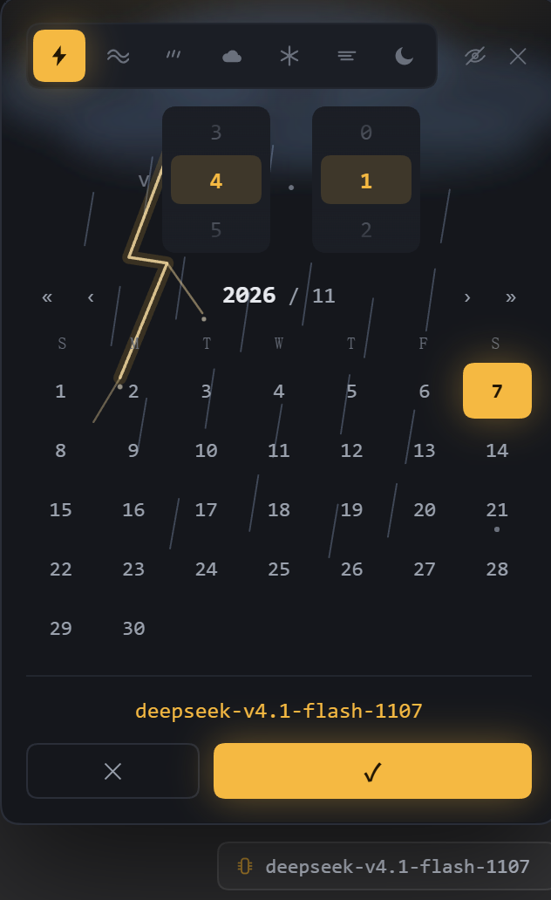
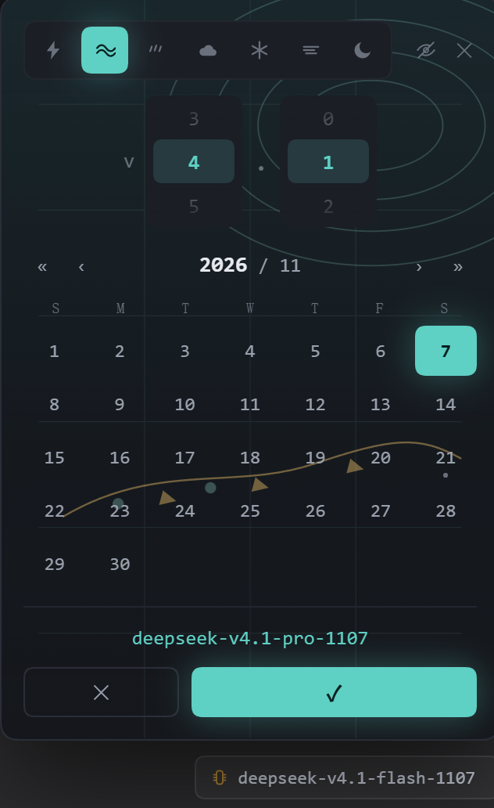

# dsh-date-model · 按日期选模型

一个 DSH Web 端的趣味插件：用「无限数字滚轮 + 月历」拼出一个假模型名，并把这个名字写进系统提示词 —— 于是问它「你是谁」，它就这样回答。

> ⚠️ **这不是真的模型选择器**：`v4.1` 就是两个随便滚的数字，天气是档位，日期是编的。它不改变真实模型、不改推理参数、不影响计费。想换真模型请用 `/model`。

| 项目 | 值 |
| --- | --- |
| DSH | `>= 0.2.2-rc.5`（本仓库在该版本上验证） |
| 平台 | Web（`dsh.client.platform: web`） |
| 名字 | `dsh-date-model`（Host 行 id：`date-model`） |
| 许可 | MIT |

## 长这样





> 两张图都是当前版本：右上角是「小眼睛」（显隐真实模型选择器），数字滚轮可以一直往下滚。

## 命名规则

```
deepseek-v  4  .  1  -  flash  -  1107
            ↑     ↑     ↑        ↑
        第一个数字 第二个  天气    月日（点月历选）
```

- 两个数字**无限**：从 0 起步、上不封顶，滚到底会自动换窗口，能一直滚到 `477`、`1000`；
- 末尾四位是月日，年份只用来翻日历；
- 名字形如 `deepseek-v<数字>.<数字>-<天气>-<MMDD>`。

### 档位 = 天气（玩梗）

七个图标就是一个档位选择器，只有图标没有文字（`title` / `aria-label` 里有名字）：

| 图标 | 档位 | 天气 |
| --- | --- | --- |
| ⚡ | `flash` | 雷阵雨 |
| 🌤 | `pro` | 气象预报图（等压线 + 锋面，prognostic chart） |
| 🌧 | `rain` | 雨 |
| ☁️ | `cloudy` | 多云 |
| ❄️ | `snow` | 雪 |
| 🌫 | `fog` | 雾 |
| 🌙 | `clear` | 晴（月夜） |

选择天气后，整块面板的配色和背景插画会跟着换。

## 界面

- **两个滚轮**：snap 吸附、中间高亮带、上下渐隐；一窗只渲染 240 个数字，滚到边缘整盘平移换窗，所以滚多久都不卡；
- **月历**：左右换月、点年份数字换年、点日期；
- **底部**：拼出来的名字 + `✕` / `✓`；
- **右上角小眼睛**：随时显隐真实的模型选择器（默认藏起来，点一下露出来；状态记在 `localStorage`，卸载插件会还原）；
- **鼠标浮在座椅上**：原生 tooltip 显示**真实模型名**（读真实座位上的当前文字，`/model` 切模型后会跟着变；读不到才退回配置里的默认模型）。

## 身份注入：问「你是谁」就报这个名字

按 `✓` 之后，浏览器半边把名字写进本插件的 **volatile 配置**，Host 半边读出来拼进系统提示词：

```
client.js ── ctx.remote.settings.update('date-model', { identity }) ──▶ profile 的 cordis.patch.yml
                                                                   │
                              ctx.systemPrompt.section()（order 9500，排在最后）
                                                                   ▼
                           系统提示词里多一段：你的名字是 deepseek-v4.1-fog-1217
```

- **不走会话命令**：命令会在对话里渲染一行 `>_ date-model-name · …`，太吵；配置写入是静默的，聊天记录里什么都不留；
- section 的 `text` 是**函数**，每次组装请求时现读 volatile 字段，所以点完 ✓ 下一句就生效，也不用重启插件；
- 排位 `9500` 在工具说明之后、结构化输出之前，尽量贴近本轮对话；
- 名字会进提示词，Host 侧再过一道白名单 `^[A-Za-z0-9][A-Za-z0-9._-]{0,63}$`，脏值直接不进提示词；
- **影响范围是整个 profile**：之后开的新会话、子 agent 都会用这个名字（见「已知取舍」）；
- 写入落在 `~/.dsh/profiles/<profile>/cordis.patch.yml` 的 `date-model` 行上，重启后名字还在。写失败（比如命名空间没挂载）时会在 console 打 `warn`，名字不生效但界面照常。

## 安装

**方式一：插件管理**（推荐）——把本包打成 tarball（`npm pack`）或指向仓库，在「插件」页安装并启用 `dsh-date-model`。

**方式二：手动**

```bash
cd ~/.dsh/profiles/<profile>
pnpm add -D dsh-date-model@<版本或本地路径>
```

然后在 profile 的 `package.json` 里把 `"dsh-date-model"` 加进 `dsh.profile.bundles`，重启 Harness（或在插件管理里启用该行）。

## 卸载

插件管理里停用 / 移除 `dsh-date-model`；或从 profile 的依赖和 `dsh.profile.bundles` 里删掉后重装依赖。真实模型选择器会自动还原。

## 已知取舍与风险

- **藏真实模型座位是 DOM 操作**：没有官方 API，只能按「同一行里、有文字且有按钮的兄弟节点」判定再 `display:none`，并打 `data-dsh-date-model-hidden` 标记以便还原。DSH 的 composer 结构一改就可能藏错东西；
- **hover 提示同样依赖 DOM**：从真实座位的 `title` / `aria-label` / 文本里挑最短的「像模型名」的那条，座位结构一变可能读不到（会退回配置里的默认模型或假名）；
- 依赖 `conversation.input.right` 槽位、`ctx.systemPrompt.section`、`ctx.remote.settings`、`.volatile()` 配置 —— 都是 DSH 内部接口，**升级 DSH 前请先跑自检**；
- 名字注入是 **profile 级**的，暂时没有按会话 / 按 agent 收窄（`AssembleContext` 只给 `scope`，拿不到稳定的会话标识）；
- 本插件以 `link:` 方式安装时，裸包名 `@deepseek-ai/schemastery` 解析不到，`index.js` 会按 `DSH_PROFILE_DIR` / `~/.dsh/profiles/*` 兜底；正常 npm 安装时走裸包名解析；
- 每次按 `✓` / 页面挂载都会写一次 profile 配置（同值会去重），不喜欢配置文件被动的话请别装；
- 名字是编的，别当真；公开场合请勿用它冒充真实模型。

## 文件

| 文件 | 作用 |
| --- | --- |
| `package.json` | `dsh.bundle.patch` + `dsh.client`（platform: web）+ `exports["./client"]` + `engines.dsh` |
| `cordis.patch.yml` | 往 profile 插一行 Host 插件（id: `date-model`），浏览器半边靠它被发现 |
| `index.js` | **Host 半边**：volatile `Config.identity` + `systemPrompt.section`（你的名字） |
| `client.js` | 全部界面（原生 DOM 弹层挂 `document.body`）+ 把名字写进配置 + hover 读真实模型名 |
| `docs/*.png` | 早期截图 |
| `scripts/check.mjs` | 无浏览器自检：注册 / 无限数字盘 / 天气 / 小眼睛 / 身份推送 / hover 提示 |
| `scripts/host-check.mjs` | Host 半边自检：Config(volatile) + section + 脏值过滤 |

```bash
node --check client.js && node --check index.js
npm run check:all
# PASS  座椅 + 无限数字盘 + 日期 + 七种天气 + 小眼睛 + 身份推送 全部通过
# PASS  Host 半边：Config(volatile) + systemPrompt section 正常（无会话命令）
```

## English (short)

A playful DSH web plugin: roll two unbounded numbers, pick a "weather" tier and a date, and it builds a fake model name (e.g. `deepseek-v4.1-fog-1217`). Pressing `✓` writes that name into the plugin's volatile config, and the Host half injects it into the system prompt, so the assistant answers "who are you?" with it.

- **Not a real model selector.** It never touches inference parameters or billing; use `/model` for the real model.
- Requires DSH `>= 0.2.2-rc.5`, web client. The real model seat is hidden with DOM surgery (no public API), so DSH UI changes may break it — run the self-checks after upgrading.
- The injected name applies to the whole profile (all sessions and subagents), not only the current session.
- Silent by design: config writes leave no trace in the conversation. Old `>_ date-model-name` lines are only from versions before 0.1.0.
- MIT licensed. `npm run check:all` runs the Node-only self-checks.

## License

[MIT](./LICENSE) © 2026 dynasturn
