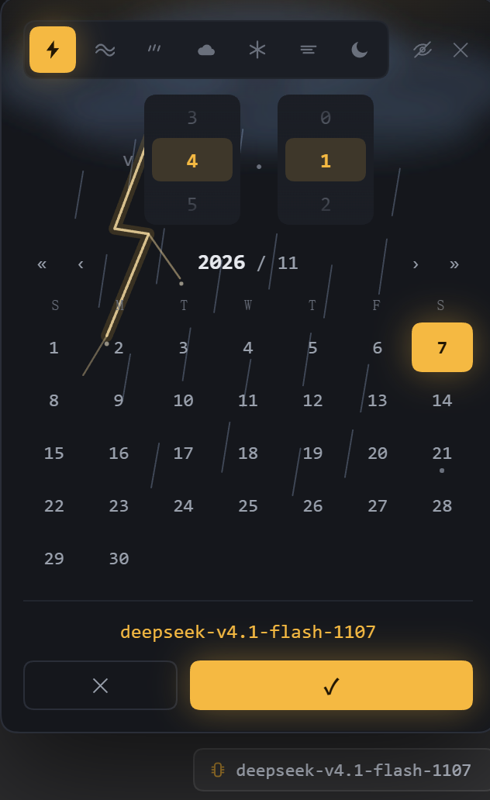
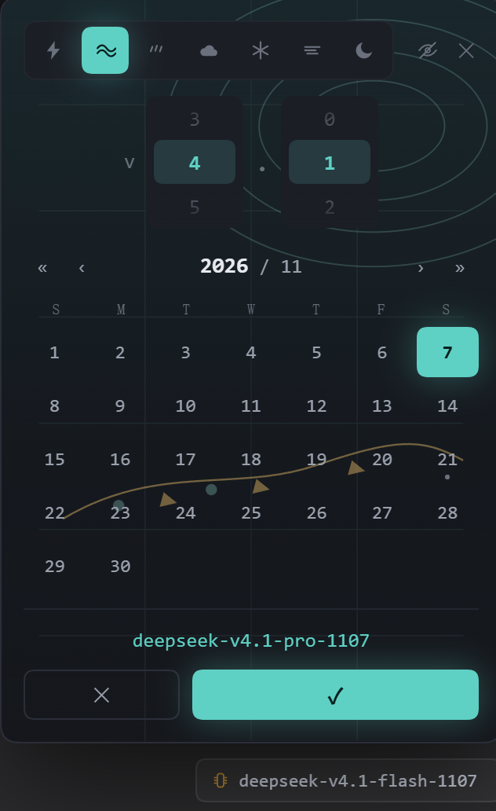

# dsh-date-model

<p align="center">
  <a href="README.md">English</a> | <a href="README.zh.md">中文</a>
</p>

DeepSeek Harness Web 输入框里的一个趣味小部件：用两个数字、一档「天气」和一个日期拼出假模型名（例如 `deepseek-v4.1-fog-1217`），并把这个名字写进系统提示词 —— 于是问它「你是谁」，它就这样回答。

> ⚠️ **这不是真正的模型选择器。** `v4.1` 只是你滚出来的两个数字，天气是装饰性的档位，日期也是编的。它不改变真实模型、不改参数、不改上下文窗口、不影响计费。想换真模型请用 `/model`（或用下面第 6 条的小眼睛把真实选择器叫出来）。

| 项目 | 值 |
| --- | --- |
| DSH | `>= 0.2.2-rc.5 < 0.3.0`（在 `0.2.2-rc.5` 上验证） |
| 平台 | Web 客户端（`dsh.client.platform: web`） |
| 包名 | `dsh-date-model` · Host 行 id `date-model` |
| 许可 | [MIT](./LICENSE) |

## 截图





两张图都是当前版本：右上角的小眼睛、可以无限滚的数字盘，就是下面描述的样子。

## 功能

### 1. 输入框里的「模型座椅」

插件注册进输入框的模型座位槽位（`conversation.input.right`），显示一个芯片，上面是**当前生效**的假名字，例如 `deepseek-v4.1-flash-1107`。

- **点芯片** → 在上面弹出面板；
- 芯片存在期间，**真实模型选择器会被藏起来**，所以输入框里只有这一个「模型」控件；想临时把它叫出来用第 6 条的小眼睛；
- 芯片按当前天气档位换强调色，`aria-label` 是假名字（读屏用）。

### 2. 两个「无限」数字滚轮

面板顶部是 `v` + 滚轮 + `.` + 滚轮。

- **不是 24 小时制。** 两个盘都不是时钟，任何非负整数都能滚，**上不封顶**：一直往下滚会经过 `23`、`59`、`477`、`1000`……
- 每个盘只渲染 **240 个数字的窗口**，滚到边缘时整盘悄悄平移换窗，所以滚多久都不会卡；
- 有滚动吸附、中间高亮带、上下渐隐，手感接近系统选择器；点某个数字可以直接跳过去；
- 存下来的是普通整数（0、1、2…），不是「几点几分」。

### 3. 月历

- `«` / `»` 换年，`‹` / `›` 换月（年份范围 1970–2100）；
- 点任意日期选中；「今天」和「当前选中」是两种不同的标记；
- 选中的月、日会成为名字最后四位：`MMDD`。

### 4. 七档「天气」（只有图标，没有文字）

面板顶部一排就是档位选择器，**只有图标**，每个按钮的 `title` 和 `aria-label` 里才有名字：

| 图标 | 档位 | 含义 |
| --- | --- | --- |
| ⚡ | `flash` | 雷阵雨 |
| 🌤 | `pro` | 气象预报图（等压线 + 锋面，prognostic chart） |
| 🌧 | `rain` | 雨 |
| ☁️ | `cloudy` | 多云 |
| ❄️ | `snow` | 雪 |
| 🌫 | `fog` | 雾 |
| 🌙 | `clear` | 晴（月夜） |

### 5. 选档位 = 整块换主题

点任意档位，整块面板会重绘：强调色、控件高亮、以及用内联 SVG 画的背景插画都会跟着换（`flash` 是雨丝加闪电，`pro` 是同心等压线加带三角的锋面，其余依次是雨点、云、雪花、雾线、月夜）。面板会自动跟随应用的浅色/深色主题。

### 6. 小眼睛：随时显隐「真实模型选择器」

小眼睛在面板右上角、关闭按钮左边。

- **默认是藏起来的**：真实模型座位被设成 `display: none`（只改显示，并打了 `data-dsh-date-model-hidden` 标记，方便还原），所以输入框里只看到一个模型控件；
- **点一下小眼睛** → 真实选择器出现在芯片旁边；再点一下 → 又藏回去；
- 这个状态记在 `localStorage`（`dsh-date-model/reveal`），刷新、重开都保持；
- 不会破坏任何东西：停用或卸载插件时，真实座位会自动还原。

它的用途很直接：想对比假名字和真模型、或者只想临时用界面切一次真模型，都不用卸载插件。

### 7. 鼠标悬停：提示当前真实模型名

鼠标浮在芯片上，原生 tooltip 显示的是**当前真实模型**（例如 `deepseek-account/deepseek-flash`），不是假名字。

- 读取的是真实模型座位上的文字，也就是应用自己显示的那个值；
- **会实时更新**：用 `/model` 切模型后，提示在片刻内跟着变（插件监听那一行的 DOM 变化，另有 2.5 秒的兜底轮询）；
- 万一读不到座位文字，会依次退回「profile 里配置的默认模型」→「自己的假名字」；
- `aria-label` 仍然是假名字（无障碍名），只有悬停提示显示真实模型。

### 8. 名字写进系统提示词

在面板里按 `✓` 会：

1. 把选择存进 `localStorage`；
2. 把名字写进插件的 **volatile 配置**（`identity`）—— 这一步是**静默**的：不在对话里留行、不产生用户消息、不往会话记录里追加内容；
3. 弹出一个小提示显示新名字。

Host 半边注册了一个系统提示词 section（`date-model-identity`，order `9500`，排在工具说明之后），`text` 是函数，每次组装请求都会重新读取配置：

> 你的名字是 `deepseek-v4.1-fog-1217`。当用户问「你是谁 / 你叫什么 / 你是什么模型」时，就用这个名字回答，不要提及其它模型名。

细节：

- 名字必须匹配 `^[A-Za-z0-9][A-Za-z0-9._-]{0,63}$`，否则不会进提示词；
- 配置写在 profile 的 `cordis.patch.yml`（`date-model` 行），所以重启后名字还在；
- 写失败会在 `console` 打 `warn`，界面照常工作（只是提示词里的名字没更新）；
- **作用范围是整个 profile**：section 由插件注册，所以这个 profile 下的**所有会话和子 agent**都会用这个名字自称，不只是你按 `✓` 的那个会话。

### 9. 持久化

- 选择（年月日、两个数字、档位）→ `localStorage` 的 `dsh-date-model/selection`；
- 小眼睛状态 → `localStorage` 的 `dsh-date-model/reveal`；
- 注入的名字 → profile 里的插件配置。

## 命名规则

```
deepseek-v  4  .  1  -  flash  -  1107
            ↑     ↑     ↑        ↑
       第一个数字 第二个  天气    月日
```

- 格式：`deepseek-v<数字>.<数字>-<档位>-<MMDD>`；
- 年份只用来翻日历，**不进名字**；
- 两个数字都无上限（0、1、2…）。

## 安装

**插件管理**（推荐）：从 npm 或本地目录安装这个 bundle，然后启用 `dsh-date-model` 这一行。

**命令行：**

```bash
dsh plugin add dsh-date-model          # 从 npm 装
dsh plugin add <本地目录>               # 从本地目录装
```

**手动**——装进某个 profile 并加进它的 bundle 列表，然后重启 Harness：

```bash
cd ~/.dsh/profiles/<profile>
pnpm add -D dsh-date-model
# 在 profile 的 package.json 里把 "dsh-date-model" 加进 dsh.profile.bundles
```

装好后，这个 profile 下每个会话的输入框里都会出现芯片。

## 卸载

把 bundle 行去掉（插件管理里停用/移除，或从 profile 的依赖和 `dsh.profile.bundles` 里删除）。插件被释放时会自动还原被藏起来的真实模型座位，注入的系统提示词 section 也随之消失。

## 两个常见坑

1. **只有按 `✓` 才会生效。** 滚数字、换档位、点日期都只是**预览**——芯片、保存的选择和注入提示词里的名字，都要按 `✓` 之后才变。现在带着未保存改动关掉面板会提示「改动未应用：按 ✓ 保存」。
2. **刚安装或刚重启后，第一次写入可能不成功。** 页面刚加载时配置服务的命名空间可能还没就绪；插件会退避重试约 30 秒，仍失败会提示「名字已保存，但没能写进提示词」。处理：把插件那一行**禁用再启用一次**（或重启 Harness）即可，界面功能不受影响。0.1.2 起已加退避重试，0.1.3 加了未保存提示。

## 兼容性与已知风险

- 需要 DSH `>= 0.2.2-rc.5 < 0.3.0`。插件用的是内部接口：`conversation.input.right` 槽位、`ctx.systemPrompt.section`、`ctx.remote.settings`、`.volatile()` 配置字段。DSH 升级可能破坏它 —— 升级后请先跑自检。
- **藏真实模型座位是 DOM 操作。** 没有官方 API，只能按结构找（同一行里有文字且有按钮的兄弟节点）再 `display: none`，并打标记以便还原。composer 布局一变，有可能藏错元素；真出现这种问题就先卸载插件。
- **悬停提示同样依赖 DOM**：读的是真实座位上的文字。座位结构变了会退回配置里的默认模型。
- **名字注入是 profile 级**的，如上所述。这是有意的简化：section 接口没有暴露稳定的会话标识，无法按会话收窄。
- 每次按 `✓` 或页面挂载都会写一次 profile 配置（同值会跳过）。不希望插件碰你的 profile 配置，请不要安装。
- 假名字容易和真模型混淆。它们是假的，请不要用来冒充真实模型。

## 文件与自检

| 文件 | 作用 |
| --- | --- |
| `package.json` | `dsh.bundle.patch`、`dsh.client`、`exports["./client"]`、`engines.dsh` |
| `cordis.patch.yml` | 往 profile 插一行 Host 插件（`id: date-model`） |
| `index.js` | Host 半边：volatile `Config.identity` + `systemPrompt.section` |
| `client.js` | 全部界面（原生 DOM 弹层挂 `document.body`）、配置推送、悬停提示 |
| `docs/*.png` | 截图 |
| `screenshots.json` | 声明给插件市场的截图 |
| `scripts/check.mjs` | 无浏览器自检：注册、滚轮、月历、档位、小眼睛、身份推送、悬停提示 |
| `scripts/host-check.mjs` | Host 自检：Config（可用时）、section 文本、脏值过滤 |
| `.github/workflows/publish.yml` | 打 tag 时：跑两套自检，再分阶段发布到 npm |

```bash
node --check client.js && node --check index.js
node scripts/check.mjs
node scripts/host-check.mjs
```

## 许可

[MIT](./LICENSE) © 2026 dynasturn
